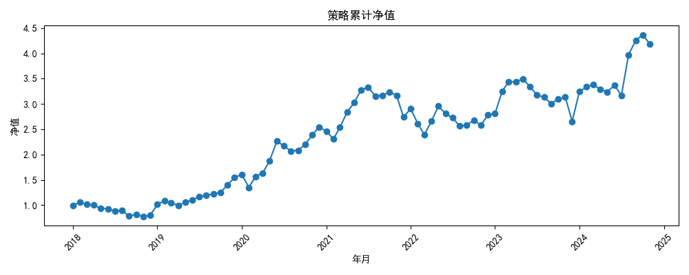
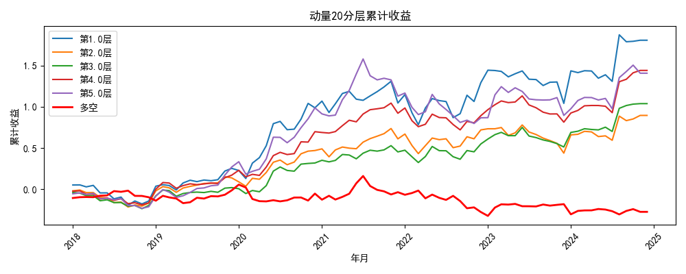
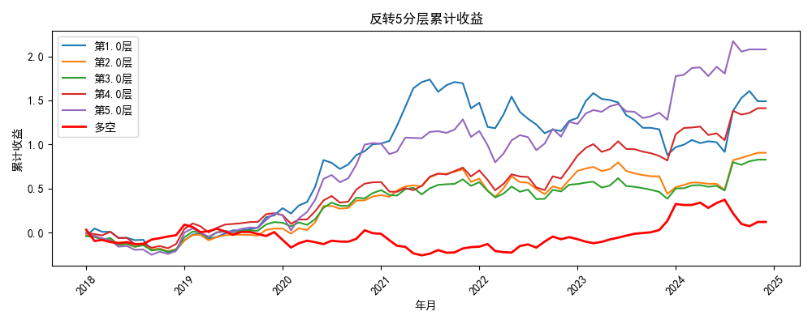
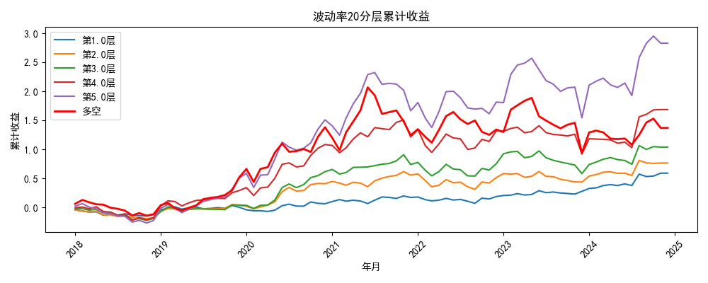

# 沪深300多因子量化选股策略

## 项目简介
本项目基于 A 股**沪深300**成分股的日频数据（2018-2024），构建了技术面多因子选股模型。项目包含完整的数据获取、因子清洗、IC/IR 检验、分层回测以及组合绩效评估流水线。策略采用月频调仓，并严格扣除双边千分之三的交易成本。

## 核心绩效与策略迭代
在研发过程中，本项目发现传统的“线性选股”极易错失超额收益。通过观察分层回测图，我们识别出了因子的“非线性（两端效应）”，并进行了深度迭代：

| 策略版本 | 累计收益 | 年化收益 | 年化波动 | 夏普比率 | 最大回撤 | 卡玛比率 | 月胜率 |
| :--- | :--- | :--- | :--- | :--- | :--- | :--- | :--- |
| **V1.0 (线性版)** | 244.79% | 19.59% | 26.36% | 0.66 | -30.33% | 0.65 | 55.42% |
| **V2.0 (非线性版)** | **318.58%** | **23.00%** | **28.70%** | **0.73** | **-28.27%** | **0.81** | **60.24%** |

> **核心洞察（非线性 Alpha 挖掘）**：
> 在分层回测中，动量与反转因子呈现显著的“V型”特征（即极端超跌与极端强势的股票均跑赢平庸的中间层）。在 V2.0 中，我们放弃了对单一方向的押注，利用**绝对偏离度**同时捕捉两端的极端情绪，并结合高波动因子。最终不仅累计收益突破 318%，**月胜率更跃升至 60.24%**，夏普与卡玛比率双双提升，极大地优化了实盘持有的体验。

> **V2.0 终极版 净值曲线**
> 

## 因子实证结论
通过对沪深300历史数据的检验，本项目得出了以下实证结论：
1. **非线性反转/动量效应**：20日动量与5日反转因子均呈现“U型/V型”分层收益。买最强势（惯性）与最弱势（超跌反弹）的股票，收益显著高于中间层。
2. **高波动溢价**：分层图显示，高波动组合（第5层）的长期累计收益远高于低波动组合（第1层）。反映了 A 股市场中高弹性资产在长期复利下的爆发力。


> **分层回测图 (两端效应明显)**
> 
> 

> 

## 项目结构
```text
Quant_project/
├── data/                  # 数据目录
├── src/                   # 核心源码
│   ├── data_loader.py     # 数据获取
│   ├── factor_builder.py  # 因子构建
│   ├── factor_evaluator.py# 因子评价
│   └── backtest.py        # 策略回测
├── notebooks/             
│   └── analysis.ipynb     # Jupyter 分析报告
├── results/               # 回测生成的图表与指标
├── README.md
└── requirements.txt